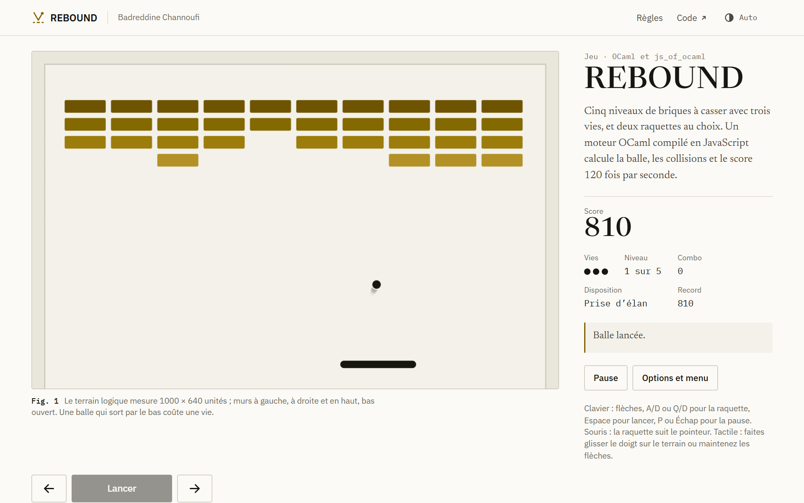
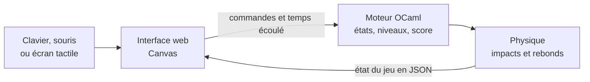

  

<h1 align="center">REBOUND</h1>

  Un casse-briques dont toute la logique est écrite en OCaml, testée en natif 
  et compilée en JavaScript avec js_of_ocaml pour tourner dans le navigateur.

  <a href="https://badreddine05.github.io/rebound/"><strong>Jouer dans le navigateur</strong></a>
  &nbsp;·&nbsp;
  <a href="docs/ARCHITECTURE.md">Le moteur et la physique</a>
  &nbsp;·&nbsp;
  <a href="https://badreddine05.github.io/">Portfolio</a>

<picture>
  <source media="(prefers-color-scheme: dark)" srcset=".github/readme/rebound-dark.png">
  
</picture>

## Le jeu

Cinq niveaux aux dispositions différentes et trois vies. À partir du troisième niveau, certaines briques demandent deux impacts, et jusqu'à trois au cinquième. La balle accélère un peu à chaque brique, jusqu'à un plafond qui dépend de la difficulté : Calme, Normal ou Expert.

Deux raquettes sont proposées. La raquette classique renvoie la balle avec un angle qui dépend du point d'impact. La raquette « Héritage · 2024 » reprend celle du projet d'origine, en trois segments séparés, avec de vrais trous par lesquels la balle peut passer.

Chaque point de résistance retiré rapporte 25 points. Une brique détruite en rapporte 75, plus 10 fois le combo en cours, plafonné à 10 ; le combo compte les briques cassées depuis le dernier rebond sur la raquette. Un niveau terminé ajoute 500 points.

## Commandes

- Clavier : les flèches, A/D ou Q/D pour déplacer la raquette, Espace pour lancer la balle, P ou Échap pour la pause, Entrée pour l'action proposée.
- Souris : la raquette suit le pointeur et un clic lance la balle. Sur écran tactile, on glisse le doigt sur le terrain ou on maintient les boutons gauche et droite, avec un bouton pour lancer.
- Le menu règle la difficulté et la raquette. Le meilleur score est gardé pour chaque combinaison. Le jeu se met en pause quand l'onglet est masqué ou que la fenêtre perd le focus, sans reprise automatique.

## Comment c'est construit

Le moteur avance par pas fixes de 1/120 s, quelle que soit la fréquence de l'écran : le jeu va à la même vitesse à 60 ou à 144 Hz, et les mêmes commandes donnent toujours la même partie. Pour chaque pas, il cherche le premier instant où la balle touche un mur, la raquette ou une brique. Une balle rapide ne peut donc pas traverser une brique entre deux images, et les coins des briques se comportent comme des arrondis.

Le navigateur ne fait aucune simulation de son côté : il envoie les commandes, reçoit l'état calculé par le moteur et le dessine. Les tests natifs couvrent les collisions à haute vitesse, les coins, les contacts simultanés, l'équivalence entre 30, 60 et 144 Hz, la pause, les vies et la progression. Un autre test charge le vrai fichier JavaScript produit par js_of_ocaml et joue 300 images.

## Lancer le projet

La compilation demande OCaml 5.3.0, Dune 3.20.2, js_of_ocaml 6.2.0 et Node.js 22 ou plus récent, de préférence sous Linux avec opam : les étapes sont dans [docs/BUILD.md](docs/BUILD.md). Sans OCaml sur sa machine, on peut lancer le workflow GitHub Actions du dépôt, qui fournit le site construit et le résultat des tests en artefact (`rebound-web`).

## Histoire du projet

Le casse-briques est né en 2024 dans un cours de programmation fonctionnelle avancée, sur un squelette pédagogique fourni (architecture ECS, rendu SDL et js_of_ocaml). Ces fichiers restent inchangés dans [`casse_briques 3/`](casse_briques%203/), tout comme le rapport et l'archive d'origine à la racine du dépôt, avec leur historique Git.

La refonte de 2026 réécrit le moteur de façon indépendante dans `core/`, en OCaml standard, et garde la raquette en trois segments comme mode de jeu. [NOTICE.md](NOTICE.md) précise ce qui vient de chaque période.

## Limites

- Cinq niveaux écrits à la main, sans génération aléatoire, et une seule balle à la fois.
- La physique est faite pour ce jeu : pas de rotation, de masse ni de rebond entre plusieurs balles.

## Licence et crédits

Le nouveau code est sous licence MIT, avec une portée précisée dans [LICENSE-new-code.txt](LICENSE-new-code.txt) ; les fichiers de 2024 ne sont pas couverts par cette licence. Les notices d'OCaml, de js_of_ocaml et des polices sont distribuées avec le jeu, dans [`licenses/`](licenses/).

Projet de cours de 2024 ; refonte par [Badreddine Channoufi](https://badreddine05.github.io/), avec l'aide d'outils d'IA. Les commits portent leurs dates réelles.

English summary

REBOUND is a brick breaker whose whole game logic is written in OCaml, tested natively and compiled to JavaScript with js_of_ocaml. The deterministic core advances in fixed 1/120 s steps and finds the exact time of each impact, so fast balls never tunnel through bricks. The browser only sends commands and draws the state the engine returns.

